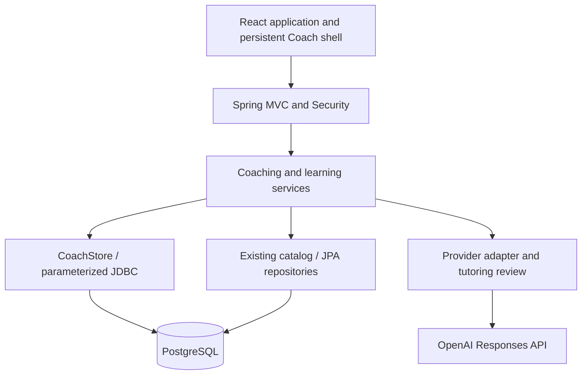

# AlgoBloom

**Your Personal AI Coding Interview Coach**

*Practice smarter. Grow with every problem.*

[AlgoBloom development branch](https://github.com/Marilyn2004/leetcode-review-system/tree/codex/v2-core-mvp)
— the repository slug is retained while the Railway rename dependency is unresolved.

AlgoBloom is an AI-powered personal coding interview coach that helps learners decide what to
practice, reason through difficult problems, and use each attempt to shape the next session.
A persistent Coach stays accessible across planning, Practice Workspaces, Learning Journals and
the Growth Timeline, with PostgreSQL-backed history as the source of truth.

## The coaching loop

1. Tell the Coach your goals, available time, or where you are stuck.
2. Review and adjust a plan draft grounded in a curated problem catalog and your learning history.
3. Explicitly confirm the current draft to create one learning session and its Journal.
4. Open a Practice Workspace, follow the official problem link, and return to the same Coach.
5. Ask for a small hint, discuss a concept or complexity, or voluntarily paste code for debugging.
6. Record your outcome, time and reflections. Future review and planning use the corrected evidence.

### Persistent AI Coach

Conversations persist across visits; the application shell preserves conversation and unsent input
across pages. Server-resolved context connects each request to its original problem and attempt,
so a late response remains associated with the problem that prompted it. Interrupted requests can
be recovered by request ID rather than blindly generating another response.

The Java provider adapter calls OpenAI’s Responses API. Strict, server-validated tools search the
catalog, retrieve owned learning context and propose plans. The model cannot confirm a plan,
write outcomes, execute code, issue SQL, or browse arbitrary URLs. Plan confirmation is an explicit,
revision-checked, idempotent transaction.

### Practice Workspace and progressive hints

Each confirmed session item has a dedicated Workspace with problem metadata, patterns, feedback
and the same Coach. Official LeetCode links open in a separate tab; AlgoBloom does not reproduce
its editor or judge, read external editor content, or run pasted code.

Hints progress through L1–L3. Full solutions require an explicit current-problem request. Concept
questions and local debugging do not mechanically advance the hint level or mark a problem solved.
A bounded semantic review can reject or rewrite tutoring output, but AI accuracy and spoiler
prevention are not guaranteed. Learners can report problematic guidance.

### Personalized learning and review

Plans combine catalog IDs, available time, preferences, due reviews and recorded attempts. Learning
evidence distinguishes independent outcomes from assistance; small samples remain “still learning”
rather than receiving a weakness label. Editing feedback recomputes derived skills and reviews.
Editable learning memory, bounded-date recaps and basic interview-target planning support continuity.

### Learning Journal and Growth Timeline

Each confirmed session creates one Journal, including multiple sessions on the same day or sessions
continued across days. Journal and Workspace share the same attempt/feedback source. Notes remain
learner-authored, searchable and editable, with browser draft recovery and version-conflict handling.

The Growth Timeline links learning sessions without streak pressure, missed-day penalties or decay.
Dates remain visible; time details are available through hover/focus or a separate mobile control.
Retries and repeated edits do not repeatedly increment growth.

## Technology

- **Backend:** Java 21, Spring Boot 4.1.1, Spring MVC, Spring Security, Jakarta Validation.
- **Persistence:** PostgreSQL; parameterized JDBC for Coach workflows; Spring Data JPA/Hibernate for
  the existing problem catalog and compatibility features; additive Flyway migrations.
- **AI:** Java HTTP client, OpenAI Responses API, strict tool schemas and bounded tutoring review.
- **Frontend:** React 19, TypeScript 5.7, Vite 6, pnpm lockfile.
- **Verification:** JUnit/Mockito/MockMvc, real PostgreSQL integration and concurrency tests,
  frontend Node test runner, TypeScript checks and Vite production build.

## Architecture



Controllers handle HTTP and delegate to services. Services enforce ownership, revision checks,
planning rules and transactional confirmation. Database constraints enforce unique session/Journal
creation; messages retain processing leases and request IDs for recovery. Session items and attempts
are separate from canonical problem metadata. Existing V1 review fields/history remain intact.

Cookie sessions, CSRF protection and owner-scoped reads/writes protect Coach resources. The frontend
renders untrusted text without accepting HTML. The API key stays on the backend, and logs avoid raw
private conversation content. See [implementation and safety details](docs/CORE_MVP.md).

## Run locally

Prerequisites: **Java 21, PostgreSQL, Node 22/24 and pnpm**. The repository includes Maven Wrapper.
The existing local role is `marilyn` with an empty local password; if your role differs, adjust the
explicit local-only datasource beans described in the guide, keeping their loopback database targets.
Never substitute a production database.

Create the dedicated local databases once:

```bash
createdb -h 127.0.0.1 -p 5432 leetcode_coach_dev
createdb -h 127.0.0.1 -p 5432 leetcode_review_test
```

Set `COACH_OPENAI_API_KEY` in your backend terminal without saving it in source or shell history.
On zsh:

```bash
read -s 'COACH_OPENAI_API_KEY?Development API key (hidden): '
export COACH_OPENAI_API_KEY
printf '\n'
bash scripts/run-local-coach.sh
```

In another terminal:

```bash
cd frontend
pnpm install --frozen-lockfile --ignore-scripts
pnpm dev --port 5173
```

Open **http://127.0.0.1:5173/coach**, create a local account, and ask for a short practice plan.
The backend binds to loopback on port 8080 by default; Vite proxies `/api` to it. The `coach` profile
uses a fixed local datasource and runs additive migrations; Hibernate validates the schema.

For a clearly labelled development demo without an AI key:

```bash
./mvnw spring-boot:run -Dspring-boot.run.arguments='--spring.profiles.active=coach --coach.demo=true'
```

Demo replies do not count as real AI verification. Full setup, compatibility flags and acceptance
commands are in [the local development guide](docs/CORE_MVP.md).

### Environment variables

- `COACH_OPENAI_API_KEY`: server-only development API key; required for real AI responses.
- `COACH_OPENAI_MODEL`: model available to your provider account; default `gpt-4.1-mini`.
- `PORT`: backend port, default `8080`; the local Vite proxy assumes 8080.
- `SPRING_DATASOURCE_URL`, `SPRING_DATASOURCE_USERNAME`, `SPRING_DATASOURCE_PASSWORD`: retained
  default-profile connection settings. They intentionally cannot redirect the explicit local/test pools.

[.env.example](.env.example) contains names/placeholders only. Spring does not automatically load
`.env` files. Never use a frontend `VITE_*` variable for secrets. Demo mode is off by default.
Production configuration and migration approval are separate from local setup.

## Testing

```bash
./mvnw test
cd frontend
pnpm test
pnpm build
```

`pnpm build` runs TypeScript checks before bundling. The verified MVP baseline has **133 backend
tests** and **12 frontend tests**. Coverage includes ownership, planning/confirmation races,
transaction rollback, shared feedback, migration compatibility, hint policy, provider contracts,
stream recovery and existing V1 regressions. Full Spring contexts use the dedicated local test pool.

Real-provider synthetic runs and sampled desktop/mobile browser checks are recorded in
[AC01–AC27 acceptance evidence](docs/ACCEPTANCE_1_1.md). They are not an independent security,
accessibility or teaching-quality certification. No fabricated screenshots or metrics are included.

## Deployment status

**AlgoBloom’s current Coach MVP runs locally and has not been deployed.** The existing legacy V1
backend remains at [its Railway URL](https://leetcode-review-system-production.up.railway.app),
using Railway-hosted PostgreSQL. That endpoint does not represent a hosted AlgoBloom frontend or AI Coach.

Railway’s production connection currently watches `main` on `Marilyn2004/leetcode-review-system`;
PR deployments were disabled when inspected. A GitHub repository rename requires explicit permission,
integration verification and a separate deployment plan. Do not point the local profile at Railway or
assume GitHub redirects preserve deployment integrations. [Rebranding notes](docs/REBRANDING.md)
record the retained identifiers and pending remote work.

## Project evolution and compatibility

The project began as a Java CLI with CSV persistence, evolved into a Spring Boot/PostgreSQL review
backend, and added a canonical catalog before the persistent AI coaching MVP. AlgoBloom is the
current product identity; the old repository, Java package, database and migration identifiers are
retained deliberately. Legacy private CRUD/statistics endpoints are denied by default in the new
app and available through an explicit local compatibility flag. Their implementation and tests remain.

Approved historical specs and attribution are preserved in [V2_SPEC.md](V2_SPEC.md),
[Product Spec 1.1](docs/PRODUCT_SPEC_1_1.md) and [catalog provenance](docs/CATALOG.md).

## Roadmap

- User review of tutoring quality and the full coaching experience.
- Production migration rehearsal, deployment configuration, monitoring and backup/recovery.
- Later: automatic learning reports, mock interviews and optional account synchronization.

These are planned work, not claims about currently deployed capabilities.
